

  <picture>
    <source srcset="./assets/hero-animation.gif" type="image/gif" />
    
  </picture>

 

<table>
<tr>
<td width="58%" valign="top">

## 01 / ABOUT THE BUILDER

<strong>B.Tech CSE student.</strong> I work at the intersection of software engineering, artificial intelligence, backend development, and data structures & algorithms.

I am passionate about building meaningful technology that solves real problems. My process is grounded in curiosity: understand the system, isolate the hard problem, build deliberately, test rigorously, and keep learning.

 

<code>ROLE  /  CSE STUDENT</code> 
<code>FOCUS /  SOFTWARE + AI</code> 
<code>MODE  /  LEARN · BUILD · ITERATE</code>

</td>
<td width="42%" valign="middle">

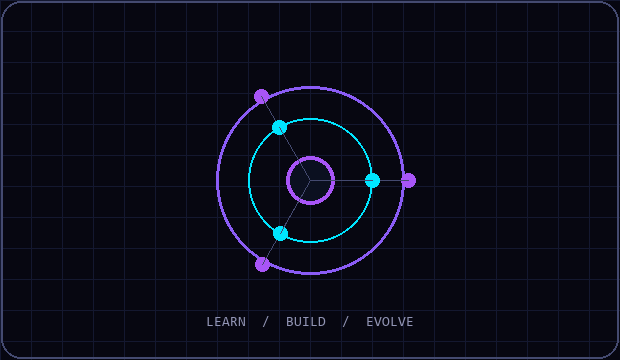

</td>
</tr>
</table>

 

## 02 / TECH ARSENAL

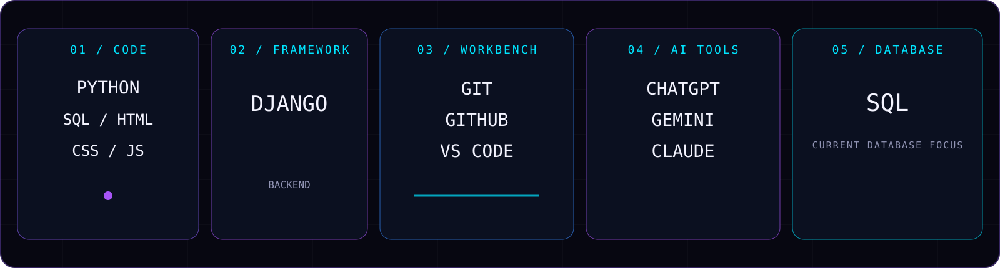

 

## 03 / SELECTED BUILD LOG

<table>
<tr>
<td width="50%" valign="top">

<a href="https://github.com/kumarimanjusrimohantycse2024-art/Ledgerleaf-Ai">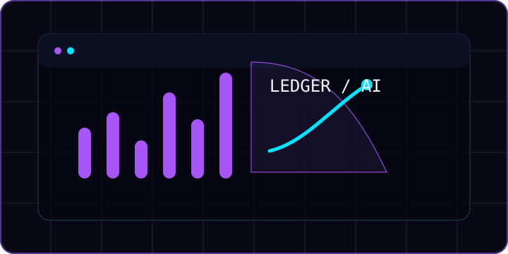</a>

### [LEDGERLEAF AI](https://github.com/kumarimanjusrimohantycse2024-art/Ledgerleaf-Ai)

AI-powered financial operations platform for agencies and service businesses, with invoice, expense, and human-approved AI workflows.

<code>Next.js</code> <code>FastAPI</code> <code>Python</code> <code>TypeScript</code> <code>React</code>

</td>
<td width="50%" valign="top">

<a href="https://github.com/kumarimanjusrimohantycse2024-art/Agentic-AI">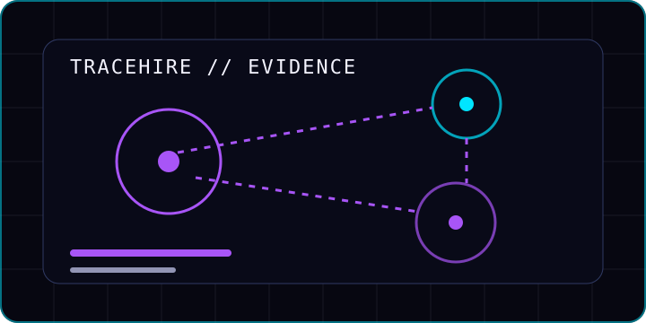</a>

### [TRACEHIRE](https://github.com/kumarimanjusrimohantycse2024-art/Agentic-AI)

An evidence-first recruiting workspace for talent screening, source-linked reports, candidate comparisons, and structured shortlist recommendations.

<code>Vinext</code> <code>React</code> <code>TypeScript</code> <code>Cloudflare D1</code>

</td>
</tr>
<tr>
<td width="50%" valign="top">

<a href="https://github.com/kumarimanjusrimohantycse2024-art/FlowZen">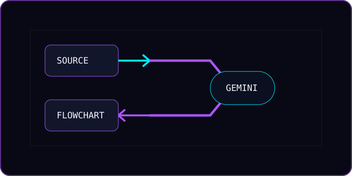</a>

### [FLOWZEN](https://github.com/kumarimanjusrimohantycse2024-art/FlowZen)

An AI-powered code-to-flowchart converter that transforms source code into structured, interactive visual logic.

<code>React</code> <code>TypeScript</code> <code>Tailwind CSS</code> <code>Vite</code> <code>Gemini API</code>

</td>
<td width="50%" valign="top">

<a href="https://github.com/kumarimanjusrimohantycse2024-art/AlgoLab-CPP">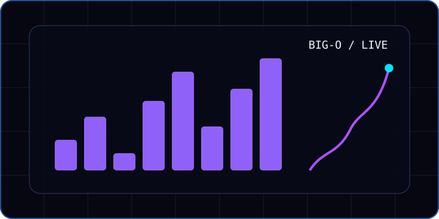</a>

### [ALGOLAB C++](https://github.com/kumarimanjusrimohantycse2024-art/AlgoLab-CPP)

A browser-based sorting visualizer that animates 10 classic algorithms with live statistics and complexity comparisons.

<code>JavaScript</code> <code>HTML5</code> <code>CSS3</code> <code>Algorithms</code>

</td>
</tr>
</table>

[EXPLORE ALL REPOSITORIES →](https://github.com/kumarimanjusrimohantycse2024-art?tab=repositories)

 

## 04 / ACHIEVEMENT SIGNALS

<table>
<tr>
<td width="50%" valign="top" align="center">

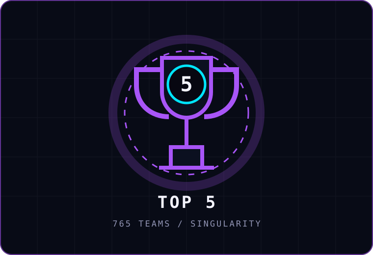

</td>
<td width="50%" valign="top" align="center">

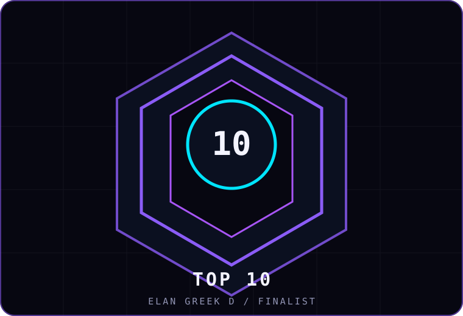

</td>
</tr>
<tr>
<td width="50%" valign="top" align="center">

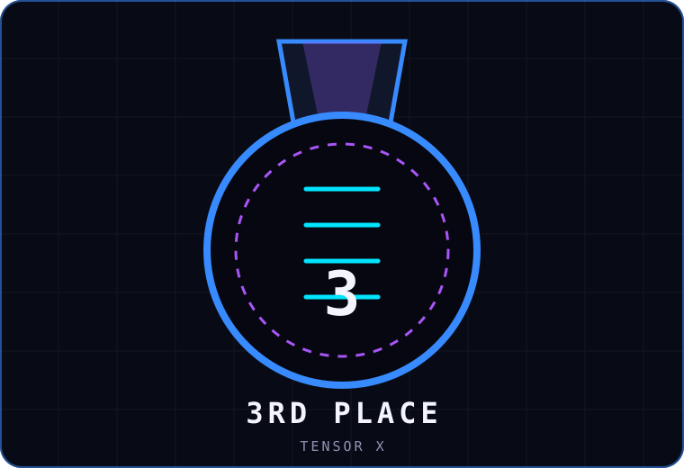

</td>
<td width="50%" valign="top" align="center">

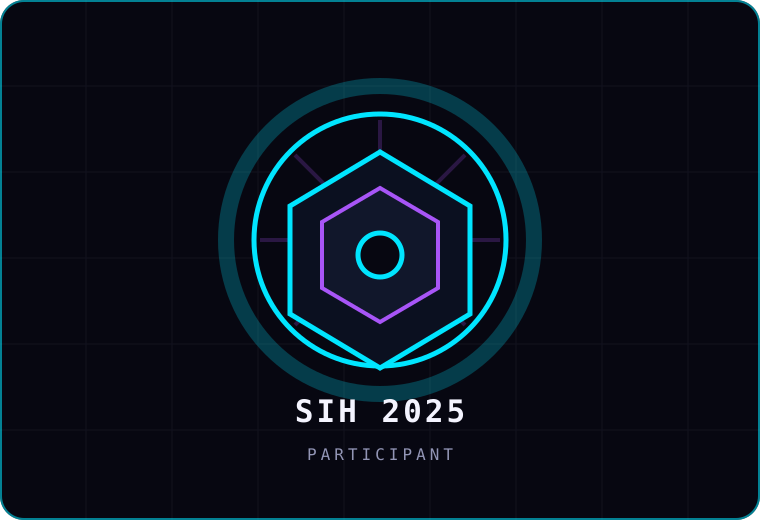

</td>
</tr>
</table>

 

## 05 / GITHUB TELEMETRY

<table>
<tr>
<td width="50%">

</td>
<td width="50%">

</td>
</tr>
</table>

 

 

[GITHUB PROFILE](https://github.com/kumarimanjusrimohantycse2024-art) &nbsp; / &nbsp; [OPEN AN ISSUE](https://github.com/kumarimanjusrimohantycse2024-art/kumarimanjusrimohantycse2024-art/issues)

 

## 06 / A LITTLE MORE ABOUT ME

<table>
<tr>
<td width="100%" valign="middle" align="center">
<picture>
  <source srcset="./assets/developer-terminal.gif" type="image/gif" />
  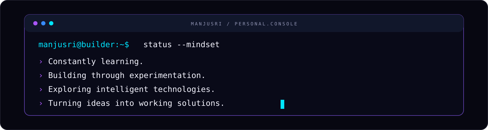
</picture>
</td>
</tr>
</table>

<code>STATUS</code> &nbsp; CURIOUS &nbsp;/&nbsp; <code>MODE</code> &nbsp; BUILDING &nbsp;/&nbsp; <code>NEXT</code> &nbsp; KEEP EXPLORING

 

## 07 / SIGNATURE ENDING

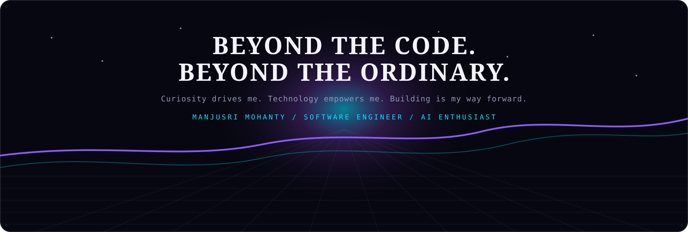

 

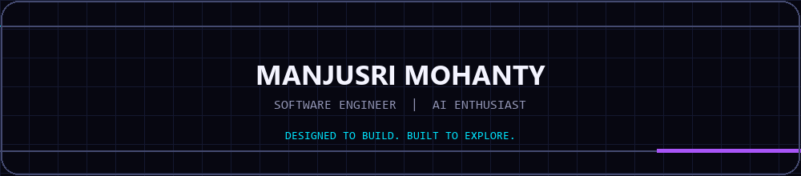

 

<a href="https://github.com/kumarimanjusrimohantycse2024-art"><strong>GITHUB</strong></a>
&nbsp;&nbsp;/&nbsp;&nbsp;
<a href="https://github.com/kumarimanjusrimohantycse2024-art/kumarimanjusrimohantycse2024-art/issues"><strong>CONTACT</strong></a>

<!--

  Static fallback is preserved by the SVG assets above.

-->
